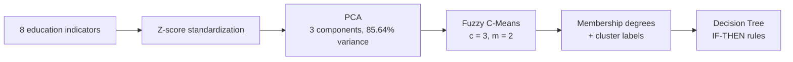

# Education Quality Clustering of Regencies/Cities in East Java

**PCA + Fuzzy C-Means + Decision Tree**

A Streamlit web application that groups the 38 regencies and cities of East Java, Indonesia, by education quality. It combines **Principal Component Analysis (PCA)**, **Fuzzy C-Means (FCM)** clustering and a **Decision Tree** classifier. Each region gets a *degree of membership* in every cluster, so regions that sit between two groups ("transitional" regions) can be identified instead of being forced into a single group.

> Final Project — Fuzzy Logic Technology (*Teknologi Logika Fuzzy*), Class D
> Informatics Study Program, Udayana University
> Lecturer: Dr. Made Agung Raharja

## Team — Group 4

| Name | Student ID |
|---|---|
| I Gusti Ngurah Agus Satria Wibawa | 2408561009 |
| I Putu Ardyana Darma Nugraha | 2408561030 |
| Anak Agung Mas Mayuri | 2408561077 |
| Philip Filadelphia Tomasui | 2408561084 |

---

## Problem Statement

Education attainment in East Java is uneven. Urban areas such as Surabaya, Malang and Sidoarjo score far higher than regions in Madura and the *Tapal Kuda* (eastern horseshoe) area. Local governments need to know which regions should be prioritized for education policy.

Hard clustering methods such as K-Means put every region into exactly one group. In reality, many regions sit on the boundary between "low" and "medium" or between "medium" and "high". Fuzzy C-Means handles this by giving each region a membership value between 0 and 1 for every cluster.

This project addresses three questions:

1. How can the 38 regions be grouped by education quality using several correlated indicators?
2. Which regions are *transitional*, meaning their membership is split between clusters?
3. What simple, interpretable rules explain why a region belongs to a cluster?

## Dataset

- **Source:** BPS (Statistics Indonesia) East Java Province
  - Mean Years of Schooling table (population aged 25+)
  - *Statistik Pendidikan Provinsi Jawa Timur* publications, 2022–2024
- **Size:** 38 regencies/cities × 3 years (2022–2024) = **114 rows**
- **Variables (8):**

| Variable | Description | Unit |
|---|---|---|
| `RLS` | Mean years of schooling, population aged 25+ | years |
| `PTT_SD` | % of population aged 10+ whose highest education is primary school | % |
| `PTT_SMP` | % of population aged 10+ whose highest education is junior high school | % |
| `PTT_SMA` | % of population aged 10+ whose highest education is senior high school | % |
| `APM_SD` | Net enrollment rate, primary school (age 7–12) | % |
| `APM_SMP` | Net enrollment rate, junior high school (age 13–15) | % |
| `APM_SMA` | Net enrollment rate, senior high school (age 16–18) | % |
| `AMH` | Literacy rate, population aged 10+ | % |

The student–teacher ratio was planned as a ninth variable. It was dropped because BPS marks it as unavailable (`...`) for 2022–2024.

## Methodology



### 1. Z-score standardization
The indicators use different scales (years and percentages), so each variable is standardized:

$$z = \frac{x - \bar{x}}{s}$$

### 2. Principal Component Analysis (PCA)
The indicators are strongly correlated with each other. PCA turns them into uncorrelated principal components by eigen-decomposing the covariance matrix:

$$C = \frac{Z^\top Z}{n-1}, \qquad C\,w = \lambda w, \qquad Y = Z W_k$$

Components are kept until their cumulative explained variance reaches ≥ 80%. This gives **k = 3 components (85.64%)**.

### 3. Fuzzy C-Means (FCM)
FCM is implemented manually in NumPy. It minimizes the objective function

$$J = \sum_{i=1}^{n}\sum_{k=1}^{c} u_{ik}^{m}\,\lVert x_i - v_k \rVert^2$$

by alternately updating the cluster centers and the membership degrees:

$$v_k = \frac{\sum_i u_{ik}^m x_i}{\sum_i u_{ik}^m}, \qquad
u_{ik} = \left[\sum_{j=1}^{c}\left(\frac{\lVert x_i - v_k\rVert}{\lVert x_i - v_j\rVert}\right)^{\frac{2}{m-1}}\right]^{-1}$$

Parameters:
- Fuzzifier m = 2
- Tolerance ε = 10⁻⁵
- At most 100 iterations
- 10 random initializations; the run with the lowest J is kept

**Choosing the number of clusters.** Values c = 2–6 were compared with five validity indices:
- Partition Coefficient (PC)
- Partition Entropy (PE)
- Modified Partition Coefficient (MPC)
- Xie-Beni (XB)
- Silhouette

MPC, Xie-Beni and Silhouette all chose **c = 3**. PC and PE tend to decrease monotonically as c grows, so they always favor the smallest c.

Clusters are ordered by their mean `RLS` value:
1. **Low**
2. **Medium**
3. **High**

A region is labeled **transitional** when its highest membership degree is below 0.6.

### 4. Decision Tree
A `DecisionTreeClassifier` (Gini criterion, `max_depth=3`, `min_samples_leaf=5`) is trained on the 8 original indicators, with the FCM cluster labels as its target. This turns the fuzzy clustering result into readable **IF-THEN rules**, and it can classify new data without running FCM again.

## Results

| Metric | Value |
|---|---|
| Number of clusters | 3 (Low, Medium, High) |
| PCA components / variance explained | 3 / 85.64% |
| Transitional data points (max membership < 0.6) | 14 of 114 |
| Decision Tree accuracy, stratified 5-fold CV | 91.15% |
| Decision Tree accuracy, training data | 98.25% |

Clusters in 2024:

| Cluster | Regions | Characteristics |
|---|---|---|
| Low | 10 | Mostly Madura and the Tapal Kuda area |
| Medium | 17 | Most regencies |
| High | 11 | Cities, plus Gresik and Sidoarjo |

The tree's main splits use `RLS` and `PTT_SMP`, which makes mean years of schooling the strongest separator between clusters.

## Application Features

The app loads the trained model from `model/`. It does **not** retrain the model.

| Page | Contents |
|---|---|
| **Beranda** (Home) | Project overview, cluster profiles, pipeline summary |
| **Prediksi** (Prediction) | Manual input for one region (with autofill from 2024 data) or CSV upload for many regions. Shows FCM membership degrees, Decision Tree class, transitional status, every computation step (z-score → PCA → distances → memberships) and the decision path. Results can be downloaded as CSV |
| **Hasil Model** (Model Results) | Cluster profiles, PCA scatter plot with cluster centers, cluster members per year, Decision Tree diagram |
| **Evaluasi** (Evaluation) | PC, PE, MPC, Xie-Beni and Silhouette scores; Decision Tree accuracy; confusion matrix (FCM vs DT); feature importance |
| **Informasi** (Information) | Methods, formulas, model parameters, variable descriptions, user guide |

### CSV input format
Required columns are the 8 variables. `kabkota` (region name) is optional. Comma or semicolon separators are both accepted. A template can be downloaded from the Prediction page.

```csv
kabkota,RLS,PTT_SD,PTT_SMP,PTT_SMA,APM_SD,APM_SMP,APM_SMA,AMH
Example Region,8.50,28.10,22.40,24.30,98.50,80.20,62.10,94.80
```

## Project Structure

```
final-project-teknologi-logika-fuzzy/
├── .streamlit/
│   └── config.toml            # Streamlit theme
├── model/
│   ├── model_pca_fcm_dt.joblib  # trained scaler, PCA, FCM centers, Decision Tree
│   └── hasil_fcm_dt.csv         # clustering results for the 114 training rows
├── app.py                     # Streamlit application
├── requirements.txt
├── Dockerfile
├── docker-compose.yml
├── .dockerignore
└── .gitignore
```

## Getting Started

Clone the repository:

```bash
git clone https://github.com/philippft/final-project-teknologi-logika-fuzzy.git
cd final-project-teknologi-logika-fuzzy
```

### Option A — Docker (recommended)

You need **Docker Engine**:
- Linux: install it natively.
- Windows: use WSL2 + Docker Engine, or Docker Desktop.

```bash
docker compose up --build
```

Open **http://localhost:8501** in your browser.

Useful commands:

```bash
docker compose up -d --build   # run in background
docker compose logs -f         # view logs
docker compose down            # stop and remove the container
```

### Option B — Python

You need Python 3.10–3.12.

```bash
python -m venv .venv
source .venv/bin/activate      # Windows: .venv\Scripts\activate
pip install -r requirements.txt
streamlit run app.py
```

Open **http://localhost:8501**.

> **Note:** `scikit-learn` is pinned to **1.6.1** because the model was saved with that version. Other versions may fail to load it or give wrong results.

## Limitations

- Each year has only 38 regions, so the dataset is small (114 rows).
- The student–teacher ratio could not be included because BPS does not provide it for 2022–2024.
- Clustering has no ground-truth labels. Decision Tree accuracy therefore measures how consistent the rules are with FCM, not correctness against real categories.
- The model must be retrained when data for a new year becomes available.

## References

1. Hermawan, & Sulaiman. (2026). *MATHunesa: Jurnal Ilmiah Matematika*, 14(2), 356–369. https://doi.org/10.26740/mathunesa.v14n02.p356-369
2. Riyadi, & Fauziah. (2024). *Jurnal Ilmiah Teknologi dan Rekayasa*, 29(2). https://doi.org/10.35760/tr.2024.v29i2.10898
3. Bezdek, J. C. (1981). *Pattern Recognition with Fuzzy Objective Function Algorithms*. Plenum Press.
4. Dave, R. N. (1996). Validating fuzzy partitions obtained through c-shells clustering. *Pattern Recognition Letters*, 17(6), 613–623.
5. Xie, X. L., & Beni, G. (1991). A validity measure for fuzzy clustering. *IEEE Transactions on Pattern Analysis and Machine Intelligence*, 13(8), 841–847.
6. BPS Provinsi Jawa Timur. *Statistik Pendidikan Provinsi Jawa Timur* 2022, 2023, 2024. https://jatim.bps.go.id
